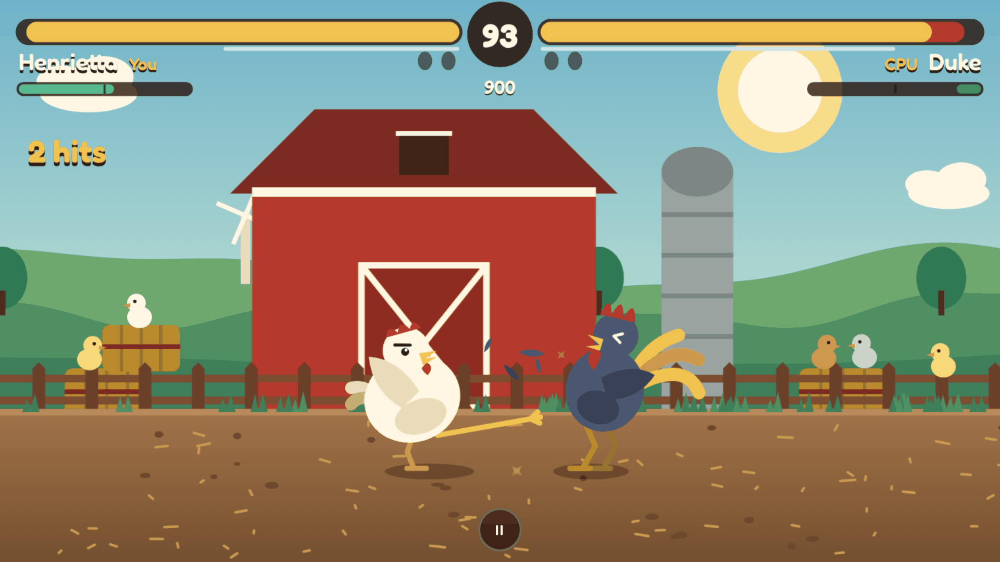

# Pecking Order

A barnyard fighting game. Peck, kick and crow your way to the top.



## Features

- **Nine fighters and a boss**, each with three specials, a super and a breed trait (hens flutter, roosters hop further, chicks scurry).
- **Modes:** Story, Arcade, Survival, Time attack, Boss rush, Tournament, Tag team, Versus, a Daily challenge, and Training with combo trials.
- **Story trails:** each story fight is reached by a short run-and-jump stage across the yard, over pits and thistles and past beetles and wasps. Corn picked up on the way is a head start on the crow meter.
- **Online play** with a friend by invite code: peer to peer over WebRTC with rollback netcode, no server needed.
- **Replays** you can share as a code, or take over and play out yourself.
- **Achievements**, 29 of them, kept on the device and listed under More.
- **Made for phones:** touch controls you can move and resize, portrait and landscape, installable and works offline. Keyboards and gamepads work too.
- **No assets:** the chickens and arenas are drawn with canvas paths, and all music and sound is synthesized live.

## Controls

| | Move | Peck | Kick | Special | Crow (super) |
|---|---|---|---|---|---|
| Player 1 | W A S D | F | G | H | T |
| Player 2 | Arrows | J | K | L | I |
| Gamepad | Stick or D-pad | X / □ | A / ✕ | Y / △ | B / ○ |

Hold away from your opponent to block (crouch for low hits). Esc pauses. Keys can be changed in Settings, and the in-game tutorials cover the rest.

## Development

```bash
npm install
npm run dev        # local dev server
npm test           # engine tests (Vitest)
npm run test:e2e   # browser smoke tests (Playwright)
npm run lint
npm run build      # bundle to a single dist/index.html
```

Pushing to `main` builds the game and publishes `dist/` to GitHub Pages (`.github/workflows/deploy.yml`).

The code is in three layers, each depending only on the one before it:

- `src/game/`: the engine. Plain, deterministic TypeScript at a fixed 60 Hz, with no DOM.
- `src/render/`: canvas drawing of the chickens, arenas and effects.
- `src/ui/`: React screens, settings and input devices.

The story's trails are a small game of their own in `src/trail/`, built the same way: deterministic rules with no DOM, and a drawing module beside them.

Fighters are data in `src/game/roster.ts`, the story script is in `src/story.ts`, and achievements are in `src/achievements.ts`. `npm run balance` plays the roster against itself, CPU against CPU, as a guide when tuning a fighter. `golden.test.ts` fingerprints the engine's behaviour, so a refactor must leave it untouched.
